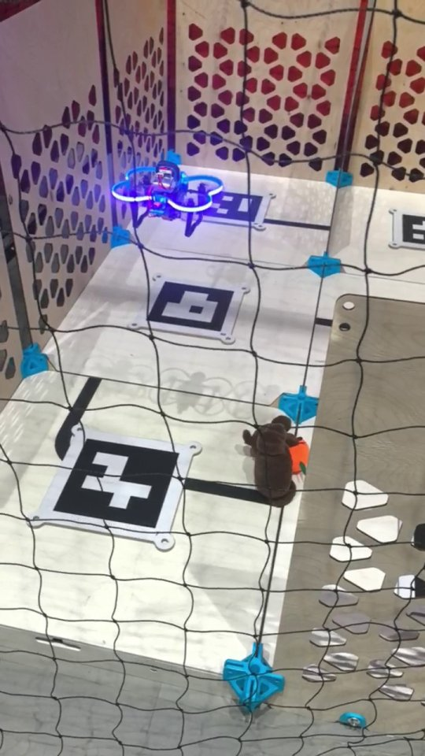
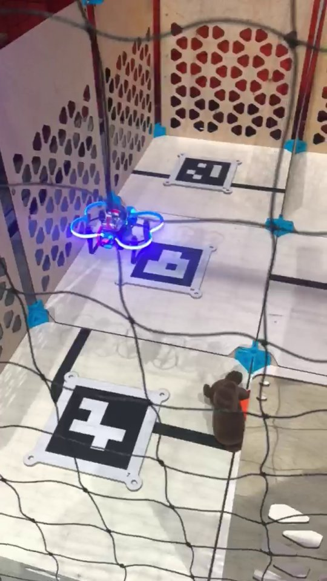
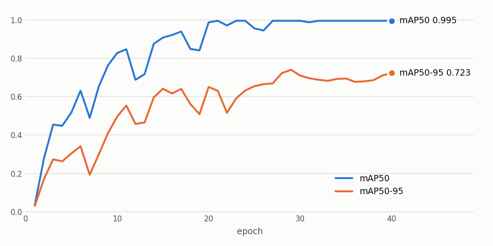

# ROS Meetup UAV Hackathon: Target Recognition from a Drone

[Русская версия](README.md)

The ROS Meetup UAV hackathon at MIPT, March 20–22, 2026, 4th place. This was team work. This repository holds my part: neural networks that recognize the targets, ROS 2 nodes on board the drone, wall detection from the camera, and flight scripts.

The drone flies over a field with ArUco markers and looks for targets: Cheburashka holding an orange, Cheburashka without an orange, and an orange on its own.

<table>
  <tr>
    <td></td>
    <td></td>
  </tr>
  <tr>
    <td align="center">Flying over the ArUco marker field</td>
    <td align="center">The drone over a marker next to a target: Cheburashka with an orange</td>
  </tr>
</table>

## What's inside

| Folder | Contents |
|---|---|
| `vision/` | ROS 2 (Humble) nodes on board. They take frames from `camera_1/image_raw`, run them through YOLOv8 every 0.5 s, publish the annotated frame to `camera_1/yolo_visual` and the target class to `yolo_result` and `yolo_label`. `model_start.py`: the classifier with a pygame window. `model_with_publisher.py` and `model_test.py`: the classifier that publishes its result, with a 0.9 confidence threshold. `model_detection.py`: the detector with bounding boxes, threshold 0.85 |
| `vision/wall_detection.py` | Walls from the downward-facing camera: Canny and HoughLinesP, with lines counted in four sectors. A sector with more than five lines counts as a wall. The result is published as a virtual laser scan, `virtual_scan`, and the debug frame goes to `camera_1/wall_debug` |
| `flight/` | `test_fly_cube.py`: a "cube" flight through the `/navigate`, `/land` and `/get_telemetry` services. It takes off, flies a square on the lower and the upper face and lands, with telemetry in a separate thread. `cube_mission.py`: the same figure through the `sverk_interfaces` library |
| `training/` | Data preparation and training. `augmentation_pipeline.py` multiplies the target photos and recomputes the boxes: rotations, brightness and contrast, noise, blur, color jitter, elastic and perspective distortions. `training.ipynb` builds the classifier and detector datasets and trains YOLOv8n-cls and YOLOv8n. `label_studio_backend.py` connects YOLO to pre-annotation in Label Studio. `webcam_classifier*.py` and `model_checker.py` test the model on a webcam. `results/` holds the parameters and metrics of the final runs |

## Results

The YOLOv8n detector trained for 40 epochs on a CPU with a 410 px input. On validation it reached mAP50 0.995, mAP50-95 0.723, precision 0.977 and recall 1.0. The YOLOv8n-cls classifier reached top-1 accuracy of 1.0.

Validation used augmented copies of the same objects, so the numbers are lower on the real field.

<picture>
  <source media="(prefers-color-scheme: dark)" srcset="docs/detector_training_dark.png">
  
</picture>

## Quick start

```bash
pip install -r requirements.txt
python training/webcam_classifier.py
```

The weights path is set at the top of each script. The `vision/` nodes target the organizers' drone: ROS 2 Humble, with the camera publishing `camera_1/image_raw`. Example: `python3 vision/model_detection.py`. Weights and the dataset are not included.

## Tech stack

Python, ROS 2 (rclpy, cv_bridge), Ultralytics YOLOv8, PyTorch, OpenCV, pygame, Label Studio, Segment Anything (an experiment in the notebook).

## License

[MIT](LICENSE)

---

<sub>The code was written in March 2026 and published on GitHub in November 2026. Commit dates follow the dates of the original files; the README and figures were added at publication. The `__init__` and `__main__` names lost in copying two training scripts were restored at the same time.</sub>
