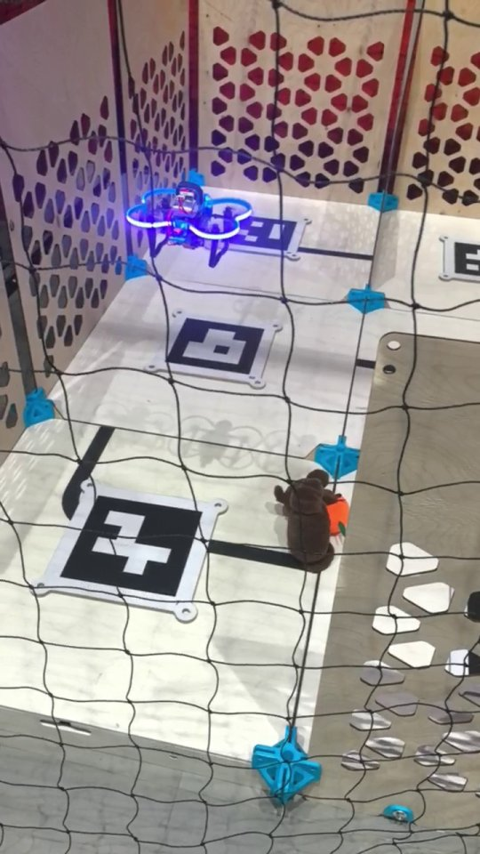
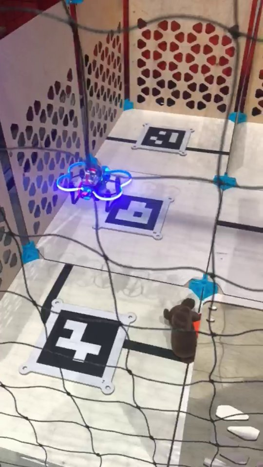
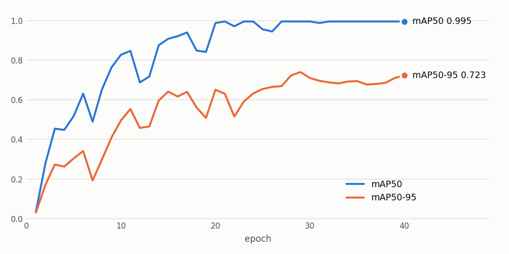

# Хакатон ROS Meetup UAV: распознавание целей с дрона

[English version](README.en.md)

Хакатон ROS Meetup UAV в МФТИ, 20–22 марта 2026, 4-е место. Работа командная. Здесь моя часть: нейросети для распознавания целей, узлы ROS 2 на борту дрона, распознавание стен по камере и полётные скрипты.

Дрон летает над полем с ArUco-метками и ищет цели: Чебурашку с апельсином, Чебурашку без апельсина и отдельный апельсин.

<table>
  <tr>
    <td></td>
    <td></td>
  </tr>
  <tr>
    <td align="center">Полёт над полем с ArUco-метками</td>
    <td align="center">Дрон над меткой, рядом цель: Чебурашка с апельсином</td>
  </tr>
</table>

## Что внутри

| Папка | Что внутри |
|---|---|
| `vision/` | Узлы ROS 2 (Humble) на борту. Они берут кадры из `camera_1/image_raw`, раз в 0,5 с прогоняют их через YOLOv8, публикуют подписанный кадр в `camera_1/yolo_visual` и класс цели в `yolo_result` и `yolo_label`. `model_start.py`: классификатор с окном pygame. `model_with_publisher.py` и `model_test.py`: классификатор с публикацией результата, порог уверенности 0,9. `model_detection.py`: детектор с рамками, порог 0,85 |
| `vision/wall_detection.py` | Стены по кадру камеры, которая смотрит вниз: Canny и HoughLinesP, подсчёт линий в четырёх секторах. Если в секторе больше пяти линий, там стена. Результат публикуется как виртуальный лазерный скан `virtual_scan`, отладочный кадр уходит в `camera_1/wall_debug` |
| `flight/` | `test_fly_cube.py`: полёт «кубом» через сервисы `/navigate`, `/land` и `/get_telemetry`. Это взлёт, квадрат на нижней и верхней грани и посадка, телеметрия идёт в отдельном потоке. `cube_mission.py`: та же фигура через библиотеку `sverk_interfaces` |
| `training/` | Подготовка данных и обучение. `augmentation_pipeline.py` размножает снимки целей с пересчётом рамок: повороты, яркость и контраст, шумы, размытия, цветовой сдвиг, упругие и перспективные искажения. `training.ipynb` собирает датасеты для классификатора и детектора и обучает YOLOv8n-cls и YOLOv8n. `label_studio_backend.py` подключает YOLO к предразметке в Label Studio. `webcam_classifier*.py` и `model_checker.py` проверяют модель на веб-камере. В `results/` лежат параметры и метрики финальных прогонов |

## Результаты

Детектор YOLOv8n обучался 40 эпох на CPU, размер входа 410 px. На валидации он дал mAP50 0,995, mAP50-95 0,723, precision 0,977 и recall 1,0. Классификатор YOLOv8n-cls дошёл до точности top-1 1,0.

Валидация шла на размноженных снимках тех же объектов, поэтому на реальном поле цифры ниже.

<picture>
  <source media="(prefers-color-scheme: dark)" srcset="docs/detector_training_dark.png">
  
</picture>

## Запуск

```bash
pip install -r requirements.txt
python training/webcam_classifier.py
```

Путь к весам задаётся в начале каждого скрипта. Узлы из `vision/` рассчитаны на дрон организаторов: ROS 2 Humble, камера публикует `camera_1/image_raw`. Пример запуска: `python3 vision/model_detection.py`. Веса и датасет в репозиторий не входят.

## Стек

Python, ROS 2 (rclpy, cv_bridge), Ultralytics YOLOv8, PyTorch, OpenCV, pygame, Label Studio, Segment Anything (эксперимент в ноутбуке).

## Лицензия

[MIT](LICENSE)

---

<sub>Код написан в марте 2026, на GitHub выложен в ноябре 2026. Даты коммитов взяты по датам исходных файлов, README и иллюстрации добавлены при выгрузке. Тогда же восстановлены потерянные при копировании `__init__` и `__main__` в двух скриптах обучения.</sub>
